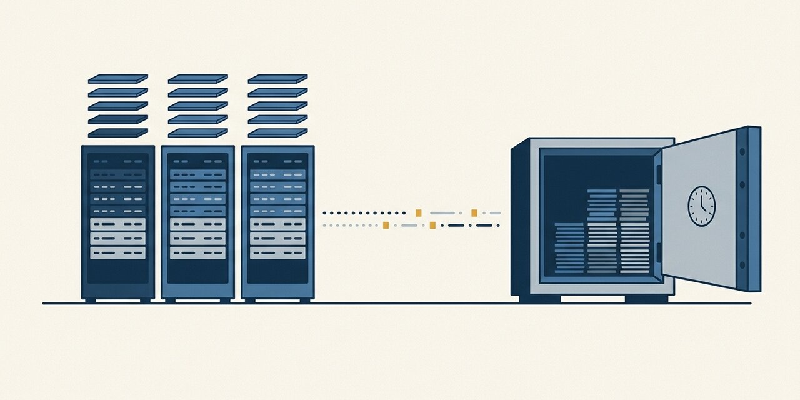
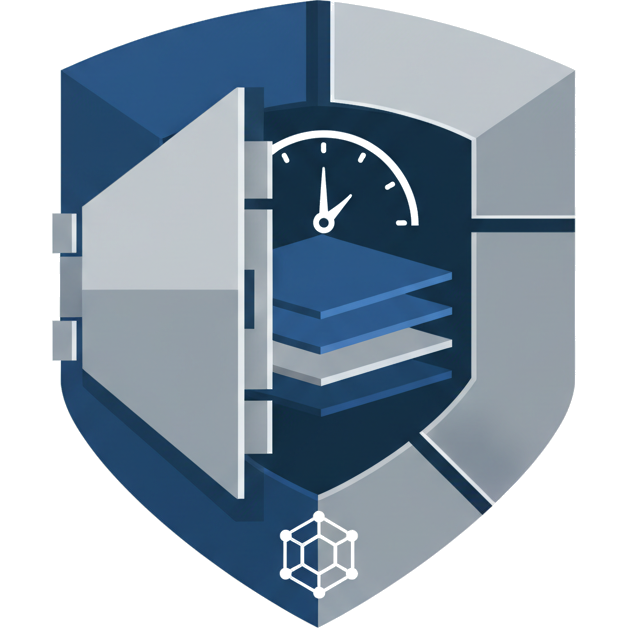
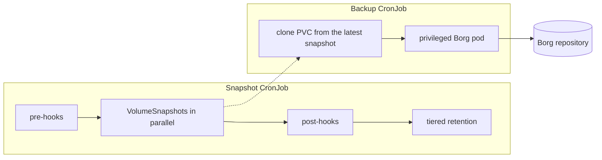

<p align="center"></p>

<table>
<tr>
<td width="100">

</td>
<td>
<h1>kube-borg-backup</h1>
Instant CSI snapshots and asynchronous BorgBackup for the persistent volumes of a Kubernetes application
</td>
</tr>
</table>

[](https://github.com/frederikb96/kube-borg-backup/actions/workflows/ci.yaml)
[](https://github.com/frederikb96/kube-borg-backup/releases)
[](LICENSE)

One Helm install backs up everything a stateful application keeps. The storage layer takes CSI snapshots in seconds while the application keeps running, with the database paused only for that moment, so nothing has to be shut down and snapshots can run as often as you like. A second job copies the latest snapshots into a deduplicated Borg repository in the background. Point it at an append-only repository and the credentials in the cluster can add backups but not erase old ones, so neither an attacker nor a mistake can destroy past backups. The price is a storage class with CSI snapshot support, which Longhorn has. Restoring is one `kbb` command, either from a local snapshot or from a Borg archive.

```console
$ kbb -n immich -a immich -r backup snap list

Snapshots for immich (3 found):

NAME                                               PVC                            CREATED                   READY
postgres-data-snap-20260610120004                  postgres-data                  2026-06-10T12:00:04Z      Yes
postgres-data-snap-20260610080003                  postgres-data                  2026-06-10T08:00:03Z      Yes
postgres-data-snap-20260610040005                  postgres-data                  2026-06-10T04:00:05Z      Yes
```

## Why

- **No downtime, and snapshots as often as you like.** A snapshot takes seconds and costs little on copy-on-write storage, so the snapshot schedule can be dense. It is a CronJob of its own, separate from the Borg schedule.
- **The live volume is never read for hours.** Borg reads a clone of the latest snapshot, so a slow offsite upload does not load the application's storage.
- **Past backups survive a compromised cluster.** Borg runs asynchronously and deduplicated against a repository that can be append-only. With an append-only key, anything the cluster deletes or prunes stays recoverable from the repository's earlier states by someone with full access. BorgBase offers append-only access per key; a self-hosted server uses `borg serve --append-only`. Create, prune, list and restore run unchanged on such a key. The space of pruned archives is freed only when someone with full access compacts the repository; the chart does not.
- **Databases stay consistent.** Exec hooks run before and after the snapshots (`pg_backup_start` and `pg_backup_stop` for PostgreSQL), and the post hooks run even when the run fails or the pod is evicted.
- **A stale volume does not produce fresh-looking backups.** A PVC whose pod has stopped being ready is not snapshotted, and the run fails, so the last good snapshots stay in the retention window.
- **One release per application.** Several applications share one chart install, one Borg repository definition and one `kbb` CLI.

## How it fits together



The two CronJobs run on their own schedules and meet only at the VolumeSnapshots. Details, including what a Borg pod does and what happens on `SIGTERM`: [docs/how-it-works.md](docs/how-it-works.md).

## What you need

- Kubernetes 1.25 or newer and Helm.
- A Borg repository reachable over SSH (BorgBase or self-hosted), with a passphrase and an SSH key for it. Give the key append-only access to get the protection described above.
- For snapshot mode, the default: a CSI driver with `VolumeSnapshot` support, a `VolumeSnapshotClass`, and a storage class that can create a PVC from a snapshot. Without snapshots, direct mode backs up the live PVC; its limits are in [docs/modes.md](docs/modes.md).

## Install

```bash
helm repo add kube-borg-backup https://frederikb96.github.io/kube-borg-backup
helm repo update

# every option, with inline documentation
helm show values kube-borg-backup/kube-borg-backup > values.yaml

helm install my-backup kube-borg-backup/kube-borg-backup \
  --namespace my-app --values my-values.yaml
```

Then trigger the first run by hand and watch it:

```bash
kubectl create job --from=cronjob/my-backup-<app>-snapshot snapshot-first -n my-app
kubectl logs -n my-app -l job-name=snapshot-first -f
kubectl get volumesnapshots -n my-app
```

The `kbb` CLI restores from a snapshot or an archive and is installed with pipx; see [docs/restore.md](docs/restore.md).

## Configuration

All settings are Helm values. The chart's [values.yaml](charts/kube-borg-backup/values.yaml) documents every option inline and is the single reference; [example/values.yaml](example/values.yaml) is a complete application with PostgreSQL hooks. Hook syntax is in [docs/hooks.md](docs/hooks.md).

## Docs

- [How it works](docs/how-it-works.md): the snapshot and backup runs step by step, the pods and images, signal handling.
- [Snapshot and direct mode](docs/modes.md): what each mode needs from the storage layer and what it costs.
- [Hooks](docs/hooks.md): consistency hooks around snapshots, and the hooks around a restore.
- [Restore](docs/restore.md): installing `kbb`, listing snapshots and archives, restoring a PVC.
- [Development](docs/development.md): checks, the files that carry the version, releasing.

## License

[MIT](LICENSE)
